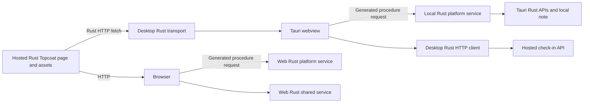

# Hosted Topcoat UI with Rust platform implementations

All application code in this example is Rust: the Topcoat view, reactive signals, event handlers, procedures, web services, native platform services, and Tauri API calls. Topcoat generates its browser JavaScript runtime; there is no handwritten JavaScript adapter and no frontend Tauri `invoke` API.

The browser uses Topcoat's normal HTTP transport. The desktop fetches the independently hosted HTML and runtime assets through a Rust custom-protocol transport, then executes the same stable Topcoat procedures in its local Rust router. Both hosts use one `Api` enum; each method handles host differences and delegation. The desktop's shared-service implementation uses a Rust HTTP client to call the remote server.



## Reusable component

The [topcoat-hybrid crate](../crates/topcoat-hybrid/README.md#desktop-setup) owns the hosted transport, URL validation, HTTP client, local URL construction, and plugin setup. Its private `src/transport` modules implement the Tauri protocol bridge; advanced configuration and headless tests use the public `TransportBuilder` and `Session` types from the same crate. It depends on no example code. The application’s `app::desktop::setup` calls `HostedApp::new(...)`, supplies `accountability_app::hybrid_procedures(api)`, installs `hosted.plugin(...)`, and opens `hosted.webview_url()`. Other apps supply their own page path and procedure router.

## Run

From the repository root, start the independently running web server:

```sh
PORT=3002 topcoat dev --package accountability-web
```

Open <http://127.0.0.1:3002/hybrid>. In another terminal:

```sh
cargo run -p accountability-desktop
```

The desktop launcher opens `topcoat://localhost/hybrid`. Its Rust transport retrieves the HTML and `/_topcoat/assets/*` from `TOPCOAT_APP_URL`. It does not render a bundled fallback page, start an HTTP listener, or expose a JavaScript Tauri bridge. The native process contains the shared Rust procedure contract and platform implementation, and uses the custom-protocol transport integrated into `topcoat-hybrid`.

Choose a separately deployed UI/server:

```sh
TOPCOAT_APP_URL=https://your-host.example/hybrid cargo run -p accountability-desktop
```

This setting selects a trusted application host. HTTPS is required except for loopback development. Redirects are not followed by the Rust HTTP client. The plugin confines the webview to its local protocol origin. The local router registers only the five hybrid procedures; application Tauri commands and global Tauri JavaScript APIs are not enabled.

Because this plugin buffers custom-protocol responses, the desktop example supports ordinary procedure responses but does not support streamed responses or WebSockets. The hosted UI remains independently deployable, provided the explicit procedure paths and record schemas stay compatible with installed desktop versions. New native functionality requires a desktop update.

## What to try

1. Click **Reload note** in browser and desktop, then save a different note in each. Reload the pages and click **Reload note** again. Each retains its own note.
2. Click **Inspect host**. The web server reports its host details. Desktop Rust reports the native application metadata and local storage path, and changes the actual native window title.
3. Click **Check in remotely** in either. Click **Refresh total** in the other to see the same remote total.
4. After loading the desktop page, stop the web server. Local note and native host procedures continue working. The remote check-in procedure returns a visible error. Reloading the hosted page requires the server.

## Rust UI and dispatch

[app/src/hybrid.rs](../examples/accountability/app/src/hybrid.rs) defines the view, signals, event handlers, result records, and stable procedure paths. A save button is authored as Rust:

```rust
@click=$(async |_e| {
    note_busy.set(true);
    note.set(platform_save(text.get()).await);
    note_busy.set(false);
})
```

`platform_save` calls the single application API in the current host's context:

```rust
app_context::<Api>(cx).save_note(text)
```

[app/src/api.rs](../examples/accountability/app/src/api.rs) defines `Api` as a `Web`/`Desktop` enum. Each variant owns its `NoteStore` and host-specific state. The web router configures it with `Api::web(notes)`; desktop setup uses `Api::desktop(app.handle().clone(), &hosted)`. Note methods share their storage implementation. Host inspection selects server information or Tauri calls. Check-ins access the counter directly on web and delegate over HTTP on desktop. Delegation is a method-level choice.

| Procedure | Web Rust implementation | Desktop Rust implementation |
| --- | --- | --- |
| `/api/hybrid/platform/read` | Read server note | Read local note |
| `/api/hybrid/platform/save` | Save server note | Save local note |
| `/api/hybrid/platform/inspect` | Server metadata | Tauri Rust APIs |
| `/api/hybrid/cloud/read` | Read hosted counter | Rust HTTP GET to hosted counter |
| `/api/hybrid/cloud/check-in` | Increment hosted counter | Rust HTTP POST to hosted counter |

The JSON endpoints `/api/hybrid/note`, `/api/hybrid/host`, and `/api/hybrid/check-ins` remain available on the web server. The desktop API calls the last endpoint. Both hosts reuse [app/src/domain.rs](../examples/accountability/app/src/domain.rs) for validation and persistence.

## Tauri API calls in Rust

[app/src/api.rs](../examples/accountability/app/src/api.rs) calls Tauri directly in `Api::desktop` and `Api::inspect_host`:

```rust
// Api::desktop resolves the local storage directory.
app.path().app_data_dir()

// Api::inspect_host accesses app metadata and the native window.
let package = app.package_info();
let window = app.get_webview_window("main");
```

The host inspection method also sets the native window title and reads it back. [app/src/desktop.rs](../examples/accountability/app/src/desktop.rs) configures the API, installs the transport, and creates the window.

The Topcoat procedure is handled on the native async runtime, leaving the UI event loop free to process native window operations. There are no `#[tauri::command]` wrappers or JavaScript Tauri API calls in this example.

[topcoat-hybrid transport](../crates/topcoat-hybrid/src/hosted_ui.rs) handles GET/HEAD requests for the hosted page and its assets. It passes procedure requests to the native router. Remote check-in requests originate from the desktop branch of `Api::check_ins`. HTML/assets are fetched remotely on page load; local API requests remain local after the page has loaded.

This is a single-user example. Browser visitors share one server note. Desktop notes are per installation. The hosted check-in count is in memory and resets when the web server restarts. Set `WEB_NOTE_PATH` to choose the server's note file. Desktop notes live in the OS app-data directory for `dev.accountability.hybrid`.

## Verification

```sh
topcoat asset bundle --package accountability-web
cargo check --workspace
cargo test --workspace --all-features
cargo build -p accountability-desktop
```

The Rust suite covers storage isolation, persistence, validation, procedures, and the reusable/custom-protocol transports. Generate the asset bundle before the tests. Browser checks exercise the generated Topcoat runtime. To exercise a real Linux Tauri webview, start the hosted app, then:

```sh
TOPCOAT_APP_URL=http://127.0.0.1:3002/hybrid \
  XDG_DATA_HOME=/tmp/accountability-hybrid-test-data \
  GDK_BACKEND=x11 TAURI_WEBVIEW_AUTOMATION=true LIBGL_ALWAYS_SOFTWARE=1 \
  WEBKIT_DISABLE_DMABUF_RENDERER=1 \
  xvfb-run -a dbus-run-session -- tauri-driver --port 4455 --native-port 4456
```

In another terminal:

```sh
python3 scripts/smoke-desktop.py
```

The script checks local persistence, an unchanged web note after desktop saves, remote check-ins, native window title and package metadata, and the absence of the public Tauri JS API. The optional `--offline-marker /tmp/hybrid-offline` pauses the script until that file exists, allowing a test runner to stop its owned server before checking that native procedures still work while remote calls fail. Linux is exercised; Windows and macOS require native runs.
